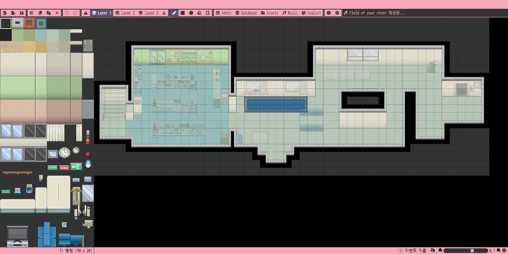
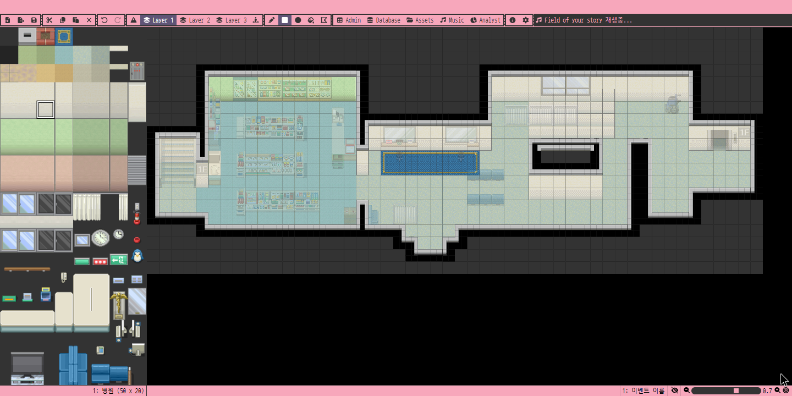
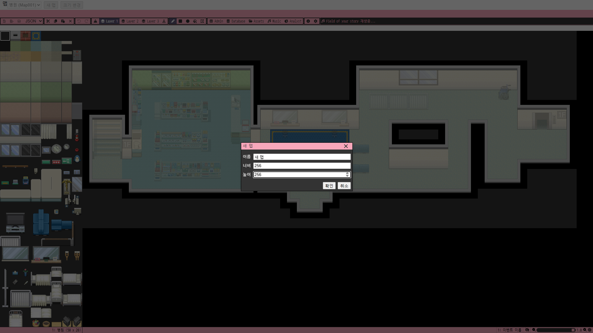

<p align="center">
  
</p>

# Usagi Studio

**작은 타일로 만드는 나만의 세계 — 브라우저 기반 타일맵 에디터**

[](#현재-구현-범위)
[](package.json)
[](package.json)
[](src/main.js)
[](src/assets/style.scss)

[](#준비-사항)
[](yarn.lock)
[](eslint.config.mjs)
[](#검증)

[사용 화면](#사용-화면) · [빠른 시작](#빠른-시작) · [기본 조작](#기본-조작) · [검증](#검증) · [기여 안내](#개발자와-기여)

---

브라우저에서 32×32 픽셀 타일과 오토타일로 맵을 편집하는 **Vue 3 기반 타일맵 에디터**입니다. 타일 팔레트, 3개 레이어, 그리기 도구와 실행 취소 기능을 갖추고 있으며, 포함된 병원 샘플 맵으로 바로 사용해 볼 수 있습니다.

> **개발 중인 프로토타입입니다.** 저장 버튼 또는 **Ctrl+S / ⌘S**로 모든 맵을 현재 브라우저에 저장하고 새로고침 후 복원할 수 있습니다. 저장하지 않은 변경은 새로고침하면 사라집니다.

## 사용 화면

실제 프로덕션 빌드를 Chromium에서 실행한 화면입니다. 왼쪽은 타일 팔레트, 상단은 도구·레이어, 오른쪽은 병원 샘플 맵입니다.



### 편집 시연

타일 선택 → 사각형 그리기 → 실행 취소·다시 실행 → 레이어 변경과 브러시 그리기 → 줌 조절 순서입니다. 아래 GIF는 **3배속·약 20초**이며, [실제 속도 MP4 영상 보기/다운로드](docs/media/editor-demo.mp4)는 **약 59초**입니다. 소리는 없습니다.


<details>
<summary>사각형 도구로 타일을 배치한 화면 보기</summary>



</details>

2026-10-17에 1440×720으로 캡처했습니다. 녹화 중 그리기와 실행 취소·다시 실행의 캔버스 픽셀 변화를 확인했습니다. 조작 순서는 [capture-demo.pw](scripts/capture-demo.pw)에 있으며, 새로 연 프로덕션 화면을 1440×720, 줌 70%로 맞춘 상태에서 실행합니다.

## 주요 기능

- **타일 선택**: 단일 타일과 직사각형 묶음 선택, 맵 우클릭으로 타일 가져오기
- **그리기**: 브러시, 사각형, 원형, 연결 영역 채우기와 오토타일 연결 처리
- **레이어**: 독립적인 3개 타일 레이어와 편집이 차단된 미리보기·이벤트 레이어
- **확대/축소**: 10–100% 줌, 슬라이더와 초기화 버튼
- **실행 취소/다시 실행**: 도구 모음과 키보드 단축키, 현재 맵에만 적용하며 다른 맵의 redo 보존
- **맵 관리**: 새 맵 생성, 목록 전환, 크기 변경, 단일 맵 JSON 가져오기

별도 백엔드나 계정 설정 없이 타일 배치와 도구 동작을 실험할 수 있습니다. Vue 컴포넌트, Canvas 렌더링, Vuex 편집 상태가 분리되어 있어 에디터 기능을 확장하기에도 적합합니다.

### 현재 구현 범위

선택 영역을 지정할 수 있지만 **영역 이동은 미구현**입니다. 잘라내기·복사·붙여넣기·삭제에는 빈 처리 함수가 남아 있습니다. Database 팝업은 샘플 UI이며, 완성된 데이터 관리 기능이 아닙니다. 관리자·에셋·음원·통계·환경설정 메뉴도 아직 동작하지 않습니다.

## 빠른 시작

### 준비 사항

- **Node.js 22.18 이상** — 검증 환경: Node.js 22.22.2
- **Yarn Classic 1.x** — 검증 환경: Yarn 1.22.22
- 데스크톱 브라우저 — 편집 회귀 검증은 Chromium에서 수행했습니다.
- 선택 사항: 프로덕션 미리보기 예제에 사용하는 Python 3

설치 시 패키지 레지스트리에 접근할 수 있어야 합니다. 앱 실행에 API 키나 환경 변수는 필요하지 않습니다. Google Fonts를 외부에서 불러오며, 연결되지 않으면 대체 글꼴을 사용합니다.

```sh
git clone https://github.com/rei-developer/usagi-studio.git
cd usagi-studio
yarn install --frozen-lockfile
yarn serve
```

터미널에 표시된 로컬 주소를 엽니다. 기본 실행 시 `Map001.json`의 **병원 맵(50×20 타일)**이 로드됩니다. 포트를 지정하려면 다음과 같이 실행합니다.

```sh
yarn serve --host 127.0.0.1 --port 8081
```

### 기본 조작

1. 왼쪽 팔레트에서 타일을 클릭하거나 드래그해 여러 타일을 선택합니다. 맨 위 줄은 오토타일 팔레트입니다.
2. 상단에서 `Layer 1`, `Layer 2`, `Layer 3` 중 편집할 레이어를 고릅니다.
3. 브러시·사각형·원형·채우기 도구를 선택하고 맵을 클릭하거나 드래그합니다. 아이콘에 마우스를 올리면 설명이 표시됩니다.
4. 맵에서 타일을 우클릭하면 해당 타일을 선택해 다시 그릴 수 있습니다.
5. 오른쪽 아래 줌 슬라이더와 버튼으로 표시 배율을 조절합니다.

| 동작 | 조작 |
| --- | --- |
| 실행 취소 | 도구 모음 또는 `Ctrl+Z` / `⌘Z` |
| 다시 실행 | 도구 모음 또는 `Ctrl+Shift+Z` / `⌘⇧Z` |
| 팔레트 선택 이동 | 방향키 |
| 줌 초기화 | 오른쪽 아래 과녁 아이콘 |

## 개발과 빌드

| 명령 | 설명 |
| --- | --- |
| `yarn install --frozen-lockfile` | `yarn.lock`에 고정된 의존성 설치 |
| `yarn serve` | 개발 서버와 핫 리로드 실행 |
| `yarn lint` | ESLint·Prettier 검사 및 자동 수정 |
| `yarn build` | 최적화된 정적 파일을 `dist/`에 생성 |

`yarn lint`는 파일을 수정하므로 실행 후 diff를 확인하세요. 빌드 도구는 Vue CLI 5 / Webpack이며, 에디터와 아이콘 정의를 지연 로딩합니다. Webpack 기본 크기 경고는 활성화되어 있습니다.

프로덕션 빌드는 `file://`로 열지 말고 HTTP 서버로 제공합니다. 예를 들어 Python 3이 설치되어 있다면:

```sh
yarn build
python -m http.server 8082 --bind 127.0.0.1 --directory dist
```

브라우저에서 `http://127.0.0.1:8082/`를 엽니다. 현재 이미지 경로는 `/tilesets/`, `/autotiles/` 등 도메인 루트를 기준으로 합니다. 하위 경로에 배포하려면 이미지 URL과 라우터 기본 경로를 함께 검토해야 합니다.

## 검증

### 개발 서버 편집 회귀 검사

`yarn serve --host 127.0.0.1 --port 8081`을 실행한 상태에서 별도 터미널을 엽니다.

```sh
npx --yes @playwright/cli -s=usagi-editor open http://127.0.0.1:8081/
npx --yes @playwright/cli -s=usagi-editor run-code --filename scripts/editor-smoke.pw
npx --yes @playwright/cli -s=usagi-editor close
```

[editor-smoke.pw](scripts/editor-smoke.pw)는 실제 마우스·키보드 입력 후 Vue 개발 상태를 읽어 타일 선택, 도형·채우기, 오토타일, 레이어, 줌, 히스토리 복원을 검사합니다. 프로덕션 빌드에서는 해당 개발 상태를 제공하지 않으므로 이 스크립트를 사용하지 않습니다.

오토타일 경계 변경은 같은 개발 서버에서 [autotile-smoke.pw](scripts/autotile-smoke.pw)도 실행하세요. 빈 칸·맵 바깥·대각선 연결, 256개 이웃 조합, 지우기와 실행 취소·다시 실행을 검사합니다.

```sh
npx --yes @playwright/cli -s=usagi-autotile open http://127.0.0.1:8081/
npx --yes @playwright/cli -s=usagi-autotile run-code --filename scripts/autotile-smoke.pw
npx --yes @playwright/cli -s=usagi-autotile close
```

### 프로덕션 검사

위의 HTTP 서버로 `dist/`를 제공한 상태에서 실행합니다.

```sh
npx --yes @playwright/cli -s=usagi-production open http://127.0.0.1:8082/
npx --yes @playwright/cli -s=usagi-production run-code --filename scripts/production-smoke.pw
npx --yes @playwright/cli -s=usagi-production close
```

[production-smoke.pw](scripts/production-smoke.pw)는 Vue 내부 상태에 의존하지 않고 캔버스 픽셀 복원, 줌 크기, Database 팝업과 콘솔 오류를 검사합니다. `.pw` 파일은 Playwright CLI에서 실행하는 JavaScript 함수입니다. 첫 실행에는 CLI 다운로드와 사용 가능한 브라우저가 필요합니다. 두 스크립트의 스크린샷은 Git에서 제외된 `output/playwright/`에 저장됩니다.

2026-10-17 로컬 검증에서는 개발 검사 **36개**, 프로덕션 검사 **8개**와 lint·빌드가 통과했으며 빌드 경고는 0건이었습니다. 이는 당시 실행 결과이며 CI 상태나 다른 브라우저의 검증을 의미하지 않습니다. 별도의 `yarn test` 명령이나 커버리지 기준은 없습니다.

## 프로젝트 구조

```text
src/
  main.js             # 앱 초기화와 전역 컴포넌트 등록
  icons.js            # 에디터 아이콘 등록
  views/              # 메인 화면과 MapEditor 조합
  components/         # 맵·팔레트 Canvas, 도구 모음
    common/           # 버튼, 입력, 다이얼로그 등 공통 UI
    popups/           # 오토타일·정보·데이터베이스 팝업
  store/              # 선택 상태, 로딩, 실행 취소/다시 실행
  router/             # 라우팅과 화면 지연 로딩
  utils/              # 타일 크기, 오토타일 매핑, 도구 상수
  assets/             # SCSS, 샘플 맵, 보존용 원본 이미지
public/               # 실행 시 제공되는 로고·타일셋·오토타일
scripts/              # 개발/프로덕션 브라우저 회귀 검사
```

핵심 동작은 [MapView.vue](src/components/MapView.vue), [TilesetView.vue](src/components/TilesetView.vue), [Vuex store](src/store/index.js)에 있습니다. 설정은 [package.json](package.json), [vue.config.js](vue.config.js), [eslint.config.mjs](eslint.config.mjs)를 참고하세요.

### 샘플과 에셋

- 기본 맵: [Map001.json](src/assets/maps/Map001.json). 로딩 위치는 [MapEditor.vue](src/views/MapEditor.vue)의 `created()`입니다.
- [Map079.json](src/assets/maps/Map079.json)은 비활성 샘플입니다. 활성화하려면 맵 ID와 JSON 로딩 경로를 변경하고 [원본 타일셋](src/assets/tilesets/Province%20de%20Vigo.png)을 `public/tilesets/`에 복사해야 합니다.
- [배포용 로고](public/logo.png)는 200×200이며, [600×600 원본](src/assets/originals/logo.png)은 별도로 보존합니다. 참조되지 않는 소스 에셋은 빌드 결과에 포함되지 않습니다.
- 실행 취소는 맵별 변경 셀을 보관합니다. 전체 맵을 합쳐 500개·64MiB 한도를 적용합니다.

## 도움말과 문제 제보

먼저 위의 실행·검증 절차와 [저장소 기여 지침](AGENTS.md)을 확인하세요. 코드와 변경 제안은 [GitHub 저장소](https://github.com/rei-developer/usagi-studio)에서 관리합니다.

문제를 제보할 때는 Node.js·Yarn·브라우저 버전, 실행 명령, 재현 단계, 기대 결과와 실제 결과를 포함하세요. 편집 문제에는 사용한 도구·레이어·줌 배율과 콘솔 오류 또는 스크린샷도 첨부하면 좋습니다. 별도의 지원 채널이나 응답 일정은 명시되어 있지 않습니다.

## 개발자와 기여

앱의 [정보 화면](src/components/popups/InfoPopup.vue)은 개발자를 **데란, 마니아**로 표기하며, Git 이력의 주요 작성자는 **INYEOB**입니다. 저장소 소유 계정은 **rei-developer**입니다.

기여 전 [AGENTS.md](AGENTS.md)를 읽어 주세요. 변경은 작고 명확하게 유지하고, PR에는 목적·검증 결과·관련 이슈를 포함하세요. UI나 편집 동작 변경에는 스크린샷 또는 짧은 녹화를 첨부하고 해당 브라우저 검사를 실행하세요. 원본 에셋과 샘플 데이터는 보존하며, 생성된 `dist/`, `node_modules/`, 테스트 출력은 커밋하지 않습니다.

## 라이선스

현재 저장소에는 `LICENSE` 파일이 없습니다. 코드와 포함된 이미지의 이용·재배포 조건을 임의로 가정하지 말고 저장소 관리자에게 확인하세요.

## 저장과 내보내기

- **모두 저장**: 현재 편집기의 모든 맵을 브라우저의 IndexedDB에 비동기로 저장합니다. 저장 중에는 중복 저장을 막습니다. 성공·실패는 상단에 표시됩니다. 같은 주소와 브라우저로 다시 열면 마지막 저장 내용을 복원합니다.
- 기존 localStorage 저장본은 검증 후 자동 이전하며 원본을 백업으로 유지합니다. 이후에는 IndexedDB 저장본을 우선합니다. 이전 실패 시 기존 저장본을 삭제하지 않습니다.
- **현재 맵 JSON 내보내기**: 현재 맵을 `Map001.json` 같은 파일로 다운로드합니다. 저장 버튼을 누르지 않은 편집도 포함하며, 세 레이어는 기존 샘플과 같은 일차원 배열로 기록됩니다. 맵 메타데이터와 충돌 정보도 유지합니다.
- 브라우저 데이터 삭제·시크릿 모드 종료 시 로컬 저장이 사라질 수 있으므로 중요한 작업은 JSON 파일로도 보관하세요. 이미지 자산은 JSON에 포함되지 않습니다. 앱에서 JSON 파일 가져오기는 아직 지원하지 않습니다.
- 저장 회귀 검사는 서버 실행 후 `npx --yes @playwright/cli -s=usagi-files run-code --filename scripts/file-smoke.pw`로 실행합니다. 먼저 같은 세션으로 로컬 서버를 `open`하세요. 테스트 전용 브라우저를 사용하세요.

### 이미지 내보내기

파일 도구 옆 **내보내기 형식**에서 PNG, JPG, WebP를 선택하고 내보내기 아이콘을 누르세요. JSON 내보내기도 그대로 사용할 수 있습니다.

- 모든 타일 레이어를 선택한 배율로 합성합니다. 기본 배율은 안전 한도 안에서 가장 높은 값입니다. 줌, 활성 레이어, 선택 테두리, 타일 번호는 출력에 영향을 주지 않습니다.
- 배율은 **100%·50%·25%·12.5%**, 한도는 **16,777,216픽셀·한 변 8,192픽셀**입니다. 출력 크기를 확인한 뒤 내보내세요. 256×256 맵은 기본 50%(4096×4096px)이며, 진행 중 취소할 수 있습니다.
- **PNG**는 무손실·투명 배경, **JPG**는 배경색을 채운 이미지(품질 95%), **WebP**는 투명 배경을 지원하는 이미지(품질 95%)입니다.
- 저장하지 않은 편집도 포함합니다. 이미지 파일에는 편집 가능한 맵 데이터가 없으므로 JSON도 함께 보관하세요. 이미지 로딩이나 인코딩 실패 시 오류를 표시합니다.
- 이미지 회귀 검사: `npx --yes @playwright/cli -s=usagi-images run-code --filename scripts/image-export-smoke.pw` (먼저 같은 세션으로 서버를 `open`).

## 대형 맵 성능과 한도

256×256 타일·3개 레이어를 검증 기준으로 사용합니다. 화면에 보이는 부분만 그리고, 커서 표시를 분리하며, 32×32 타일 구역 캐시는 64MiB로 제한합니다. 오토타일 조합은 한 번 만든 아틀라스를 재사용합니다.

실행 취소는 변경 셀만 저장하며 undo·redo 합계 500개 또는 변경 데이터 64MiB까지 보관합니다. 한도를 넘으면 오래된 이력이 제거되고 안내가 표시됩니다. 내용이 같은 작업은 redo를 지우지 않습니다.

측정 환경·결과·재현 명령은 [성능 보고서](docs/PERFORMANCE.md)를 확인하세요. 512×512는 한계 측정 대상이며 지원 보장 범위가 아닙니다. 새 맵 생성·크기 변경·JSON 가져오기는 각 변 1–256 타일을 지원합니다.

## 새 맵·크기 변경·JSON 가져오기



1. 상단 **새 맵**에서 이름·너비·높이를 입력합니다. 기본값은 50×20이며, 현재 타일 자산을 사용하는 빈 3개 레이어 맵이 추가됩니다.
2. **맵 선택** 목록에서 작업할 맵을 전환합니다. 전환 시 줌·레이어·선택이 초기화되며, 맵별 이력은 유지됩니다.
3. **크기 변경**은 좌상단 기준으로 타일을 보존합니다. 확인창에서 잘릴 타일 수를 확인하세요. 적용 시 해당 맵 이력만 삭제됩니다. 이벤트가 있는 맵은 크기를 변경할 수 없습니다.
4. **맵 가져오기** 아이콘에서 이 편집기가 내보낸 단일 맵 JSON을 선택합니다. 최대 16MiB·각 변 256타일이며, 필요한 PNG가 `public/tilesets/`와 `public/autotiles/`에 있어야 합니다. 이미지 업로드와 프로젝트 백업 파일 가져오기는 지원하지 않습니다.
5. 생성·가져오기는 기존 맵을 덮어쓰지 않습니다. **모두 저장**을 눌러야 다음 실행에서도 복원됩니다. 저장 준비 중 편집 입력은 잠시 잠기며, 저장 중에는 맵 구조를 변경할 수 없습니다.

새 기능 검증:

```sh
node scripts/map-operations-check.mjs
# 프로덕션 서버를 연 테스트 전용 세션
npx --yes @playwright/cli -s=usagi-files run-code --filename scripts/map-files-smoke.pw
# 개발 서버를 연 테스트 전용 세션
npx --yes @playwright/cli -s=usagi-dev run-code --filename scripts/map-lifecycle-smoke.pw
```

검사는 브라우저 저장소를 임시 사용하고 복원합니다. 실제 작업 중인 브라우저 세션에서는 실행하지 마세요.
